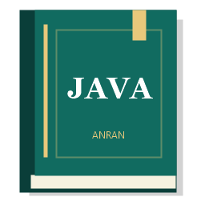

# 安染的java私人图书馆

把 Java 学习笔记、知识点讲解和自己写过的代码放在一起，像翻书一样按章节阅读，也能通过关键词快速检索。

**当前出版版本：v0.1。** 本项目使用 VitePress + Vue + Markdown，默认在本机浏览器中阅读。

## 笔记仓库与配套源码

本项目是一个**独立仓库**，用于维护知识库网站、整理后的笔记、目录与阅读组件。

笔记中涉及的完整 Java 练习与项目源码，请前往同名的 **[JavaCode 仓库](https://github.com/Anran-code/JavaCode)** 下载或克隆，并在本地保留文件夹名 `JavaCode`。完整的 JavaCode 项目不放入本仓库。

推荐将两个仓库放在同一级目录：

```text
你的工作目录/
├── JavaKnowledgeBase/    本笔记仓库
└── JavaCode/             配套 Java 练习与项目源码
```

下载配套源码：

```bash
git clone https://github.com/Anran-code/JavaCode.git
```

`knowledge.config.json` 默认通过 `../JavaCode` 定位源码仓库；此路径相对于本笔记仓库根目录解析。若放在其他位置，修改其中的 `sourceRoot` 即可。

启动和构建时，会**只读读取**指定的 Java 源文件与基础笔记，在本项目中生成展示快照，不修改 JavaCode 中的文件。源码同步不会自动重写章节讲解。其他章节的原笔记下载副本是导入时的快照，后续需随整理工作更新。

## 快速开始

需要 Node.js 与 npm（本项目已在 Node.js 24 环境验证）。先准备好上面的配套 JavaCode 仓库，再进入本笔记仓库执行：

```bash
npm ci
npm run dev
```

浏览器打开终端显示的地址：<http://127.0.0.1:5178/>。Windows 也可以双击根目录的 **启动知识库.cmd**。

开发服务运行期间保留终端窗口；按 Ctrl+C 可停止。首次安装依赖需要联网，依赖和配套源码准备完成后可以本地阅读。

## v0.1 包含什么

- **全书总目录**：8 个学习部分、24 个章节与专题，支持总目录 → 分部 → 章节以及返回导航。
- **Java 基础样章**：10 个知识小节，结合基础笔记与 10 份真实 Java 源文件讲解。
- **源码阅读**：关键片段／完整源码切换、语法高亮、复制和下载。
- **检索与阅读**：中文关键词和 API 搜索、章节目录、上下节导航、已读标记、深浅主题和窄屏适配。
- **交互反馈**：章节条目与分部卡片在悬停或键盘选中时呈现绿底白字。
- **Windows 启动支持**：书本图标、隐藏启动脚本，等待本地服务就绪后打开默认浏览器，重复启动复用已有服务。

8 个部分分别为：语言基础、面向对象、常用类与 GUI、异常与集合、IO 与并发网络、反射与注解、项目实战、语法速查。

**当前完成的是 Java 基础样章；其余章节已导入知识点目录、原笔记入口或源码位置，正文尚待逐章整理。** “目录已导入”不代表该章节已经完成出版整理。

完整更新记录见 [CHANGELOG.md](CHANGELOG.md)。

## 常用命令

| 命令 | 用途 |
| --- | --- |
| `npm run sync` | 从本地 JavaCode 生成指定源码和基础笔记快照 |
| `npm run dev` | 先同步，再启动支持热更新的开发服务 |
| `npm run build` | 先同步，再生成静态网站 |
| `npm run preview` | 预览已构建的网站，不重新同步或构建 |

## 小点子：把私人图书馆放到桌面

Windows 下可以为本地 Web 知识库创建一个桌面入口，名字是 **安染的java私人图书馆**。图标是一本写着 JAVA 的绿色书本。



### 首次创建

1. 按前面的说明准备两个仓库，并在本仓库根目录执行：

   ```bash
   npm ci
   npm run build
   ```

2. 双击根目录的 **[创建桌面快捷方式.cmd](创建桌面快捷方式.cmd)**。
3. 桌面出现书本图标后，双击即可打开图书馆。

脚本自动获取当前仓库位置和 Windows 桌面路径，也适用于已重定向到 OneDrive 的桌面，不需要手动填写磁盘路径。仅为当前用户创建快捷方式，无需管理员权限。

### 双击之后发生什么？

桌面快捷方式 → 隐藏启动器 → 启动本地网页服务 → 等待网页就绪 → 打开默认浏览器。

不需要手动输入地址，也不会弹出命令窗口。若本地服务已运行，会直接复用。仍然可以双击 `desktop/open-library.vbs` 打开应用，不必先创建快捷方式。

### 更新与维护

- 再次运行创建脚本会更新本应用已有的快捷方式；遇到同名的其他快捷方式会提示，不会覆盖。
- 移动仓库文件夹后，重新运行创建脚本，更新快捷方式中的路径。
- 关闭浏览器后，本机服务仍在后台运行；不设置开机自启。重启电脑后再双击图标即可启动。
- 修改笔记后需要重新执行 `npm run build` 并重启原预览服务，桌面入口才会显示新的构建；编辑过程中建议使用 `npm run dev`。
- 启动日志和服务进程号保存在 `.runtime/`。启动失败时会弹出提示。

图标、启动器和创建脚本纳入本仓库；生成的 `.lnk` 文件包含各自电脑上的路径，因此由脚本在本地生成，不提交到 Git。

## 文件结构

```text
docs/
├── index.md                    全书总目录
├── parts/                      8 个分部目录
├── basics/                     已整理的 Java 基础样章
├── chapters/                   后续章节的目录骨架
├── public/notes/               已导入的原笔记副本
└── .vitepress/
    ├── config.mts              导航、搜索与站点配置
    └── theme/                  阅读组件、目录数据与样式
scripts/sync-sources.mjs         只读同步源码的脚本
desktop/                        Windows 启动脚本与书本图标
knowledge.config.json           本地配套源码的位置
```

依赖、构建输出、运行日志、自动生成的高亮数据和源码下载快照均不提交，由安装、同步和构建命令重新生成。

## 当前边界

本项目用于个人学习资料整理，不在网页中执行 Java，没有账号系统或服务端数据库。“已读”状态只保存在当前浏览器，清理浏览器数据会重置。

v0.1 不含 GitHub Pages 自动部署。练习源码保留原始写法，发现的易错点在讲解中标注；学习案例不等于生产级实现。
